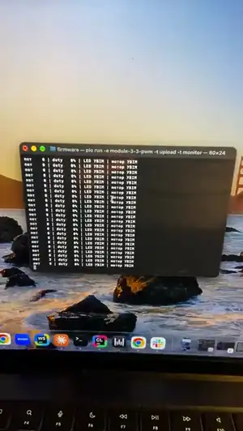

# Модуль 3.3: потенціометр керує LED і мотором

Домашнє завдання курсу Embedded Basic: потенціометр керує яскравістю LED і швидкістю мотора, вони не впливають одне на одного.
Плата ESP32-S3-WROOM-1-N16R8, PlatformIO, Arduino.



Анімація — перші 20 с. Відео повністю (76 с): [demo.mp4](demo.mp4)

## Схема

Розводка на макетці: [map.svg](map.svg). На макетці стоять ще деталі інших домашок.

```
Потенціометр: краї на 3,3 В і GND, повзунок -> GPIO5
GPIO18 -> 220 Ом -> LED -> GND
GPIO13 -> 1 кОм -> база 2N2222A, емітер -> GND
колектор -> мотор -> +5 В
діод 1N400x паралельно мотору, смуга на +5 В
```

## Що робить

LED і мотор на різних каналах і різних таймерах LEDC:

| Вихід | Канал | Частота | Розрядність |
|---|---|---|---|
| LED | 0 | 5 кГц | 10 біт |
| мотор | 2 | 10 кГц | 10 біт |

| Клавіша | Дія |
|---|---|
| `m` | мотор увімк/вимк |
| `l` | LED увімк/вимк |

## Результат

- Потенціометр дає 0…4095, заповнення у лозі 0…100 %.
- Коли мотор вимкнений, LED далі йде за потенціометром, і навпаки.

Заповнення в обох виходів береться з одного потенціометра, тож вони змінюються разом, а клавіші вимикають кожен окремо. Струм і реальну частоту не міряв.

## Запуск

```
pio run -t upload -t monitor
```
